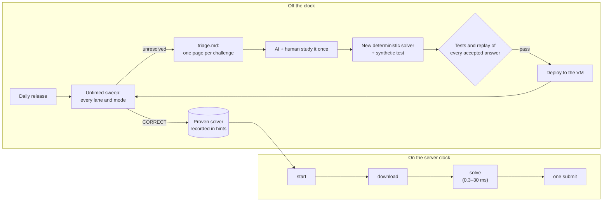

# Huntress CTF Robot

**An autonomous, deterministic solver pipeline that played the Huntress CTF 2026 "AI Arena" for a
four-person team.** AI is used to understand a new kind of challenge once. That understanding is
then written down as plain Python, so every later variant is solved by code in milliseconds.

> Independent team project, built during the event (17–31 October 2026). Not affiliated with or
> endorsed by Huntress. The Game Master service it talks to existed only for the event.

---

## The challenge

Huntress CTF 2026 changed the format. The organizers wanted teams to build a robot to play the
CTF. They did not want players solving challenges by hand. Every day for a month, new challenges
were released in six lanes, and each challenge came in three modes:

| Mode | What it asks | Why it is hard |
| --- | --- | --- |
| **Single Solve** | One static challenge, no timer | A new question type each day |
| **Time Trial** | One fresh variant against a server-side clock (about 50 s) | An AI that has to think during the attempt runs out of time |
| **Mastery** | Many variants at once, sometimes 10,000+ questions, one deadline | One wrong answer rejects the whole request |

Every team gets its own variants and flag values, and a Hall of Fame ranks the fastest timed
attempts. So the result comes down to how fast and how reliably the team turns a new idea into
working code.

## The idea: AI learns once, code answers forever



* **Single Solve is where the robot learns.** Each challenge it cannot finish leaves a
  `work/<id>/` folder with the assignment, every delivered file and a one-page `triage.md`
  covering the file kind, unpacked members, metadata, IOCs, decoded blobs and any decoded
  "answer:" statements.
* **A solver is the deliverable.** An answer only counts as done once it is a solver module with
  a synthetic test. Solvers are deterministic, use no network and no AI, and rely on the standard
  library first.
* **Timed runs are pure code.** Everything except *start → download → solve → submit* happens
  before or after the clock. Proven solvers run first, and the timings are logged in milliseconds.

## Six lanes, one robot

| Lane | What the robot does |
| --- | --- |
| **Warmups** | Peels stacked encodings (Base64/32/85, hex, binary, Morse, ROT13/47, run-length, braille, NATO, zlib/gzip, …) until the text states an answer. It also learns each day's new layer in a running curriculum. |
| **Metadata Forensics** | Uses stdlib parsers for 30+ formats: EXIF/GPS, PDF Info/XMP, OOXML, OLE2/MSI, .NET metadata, LNK, MP4/Matroska, PE/ELF/Mach-O/WebAssembly, EVTX, registry hives, Prefetch, VHD/VHDX, X.509, … It maps each `Determine <property>` question to a field. |
| **Script Analysis** | Deobfuscates layered scripts (decimal, XOR, Base85, zlib, URL encoding, string splitting, …) and answers indicator, campaign and syntax questions. It answers a day's 10,000+ Mastery questions in under half a second. |
| **Binary** | Static analysis of PE, ELF, Mach-O, .NET and WebAssembly files: headers, sections, resources, overlays, and embedded configs found through XOR, compression and CRC-validated records. |
| **Mobile Android** | Reads the binary manifest, DEX and resources. **`dexvm.py` interprets Dalvik bytecode in Python** with exact int/long semantics, plus a small x86-64 subset for JNI calls, so the app's answer is computed without ever running the app. |
| **Web Exploitation** | Curriculum handlers for live targets (backup files, SSRF, forged webhooks, role and header bypasses, …). They use scoped HTTP with request and time budgets, and wait for a target to be ready before the clock starts. |

## Engineering highlights

**Milliseconds on the clock**
- Downloads are *hedged* on a second warm connection, and the first answer wins. A POST is never
  hedged. Multi-file deliveries are fetched in parallel over six connections.
- Request pipelining is probed per route and turned on only where it measurably helps.
- The server clock is estimated with NTP correction, so the reported time matches what the
  Hall of Fame measures.

**Answers that fix themselves**
- A Mastery request is all-or-nothing. When one is rejected, the robot resends it *kind by kind*
  and then **splits the rejected kind in halves** until it has identified the wrong answers. The
  correct ones are accepted along the way, so one bad answer among fifteen costs one answer, not
  fifteen.
- Solvers can offer alternative spellings that the same evidence allows (a decimal code, a hex
  code or a label). Untimed, the robot tries them one at a time and records which one the grader
  accepted. On the clock, it never guesses.
- The robot remembers routes the grader turned down, so it never spends a ranked attempt on an
  answer it already knows is wrong.

**Never freeze on something new**
- On Linux, each solver runs in its own forked process with a wall-clock budget and a memory cap.
  A hang or crash costs that solver only, and the attempt's deadline caps the whole solve so the
  race always reaches its submit.
- Archives (ZIP including ZipCrypto and HMAC-checked AES, gzip, tar) are unpacked in memory, with
  decompression-bomb limits.
- A fuzzing harness gives every solver truncated, bit-flipped and forged inputs. A broken file must
  produce a clean "no answer".

**A release day loop measured in minutes**
- `autoprop` maps a never-seen `Determine <property>` question to a clearly matching field
  automatically, and keeps the mapping once it scores.
- A *release agent* runs headless Claude Code in its own worktree, without the token and without
  submitting anything. It writes the missing solver on a branch, and a human reviews and merges it.
- Every deploy replays every assignment the robot has ever scored. A change that breaks an accepted
  answer, or doubles a solver's runtime, is refused. A targeted fast deploy shipped a new Metadata
  parser in 74 seconds.

## Results

- **Every challenge in every lane and mode for days 1–20** solved as of 21 October. From day 21
  on, the robot played each new day from the moment it was released.
- **285 ms** on the server clock for a Warmups Time Trial. The solve itself takes 0.3–30 ms.
- Offline replay against the answers the grader accepted:
  - 950/950 Warmups questions and 947/947 Metadata questions
  - 1,329/1,329 and 1,373/1,373 Script questions on two consecutive days
  - 10,465/10,465 Mastery questions on one day of Script Analysis
- About 24,000 lines of Python in `src/` and 13,000 lines of tests (all synthetic fixtures). The
  core client has no third-party dependencies.

## Built with AI, raced without it

The repository is set up for AI pair-programming:
- [`CLAUDE.md`](CLAUDE.md) holds the working notes the coding agent reads first: the daily loop,
  the solver rules, every grader convention learned the hard way, and the release-day checklist.
- [`.claude/agents/`](.claude/agents) contains specialist subagents for the two heaviest lanes
  (Android and Binary). Each one delivers a solver and a test, and never submits anything.
- [`scripts/release-agent.sh`](scripts/release-agent.sh) runs the unattended "write the missing
  solver" step, gated by tests and replay.

The AI writes and explains code. It is never part of the solving loop on the clock.

## Repository tour

```
src/huntress_ctf/
  client.py, fastpath.py, network.py    Game Master client and the timed race engine
  daily.py, learn.py, hints.py, corpus.py  untimed sweeps, self-healing submits, memory
  containers.py, decoders.py, evidence.py  unpacking, layered decoding, IOC/metadata extraction
  formats.py, formats_dfir.py, macho.py  stdlib parsers for executables and forensic formats
  dexvm.py                               Dalvik bytecode interpreter (+ x86-64 subset for JNI)
  watchdog.py, fuzz.py                   per-solver budgets and the fuzzing harness
  solvers/                               one module per lane, auto-discovered
tests/                                   synthetic fixtures only, built inside each test
scripts/                                 VM operations, replay, release agent, offline tools
docs/                                    usage guide and the team's internal planning notes
```

## Try it offline

No token is needed for anything offline. Python 3.10 or later:

```sh
python -m venv .venv
.venv/bin/pip install -e ".[analysis]"        # Windows: .venv\Scripts\pip ...
.venv/bin/python -m unittest discover -s tests
python -m huntress_ctf triage <file>          # one page: kind, members, fields, decoded blobs
python -m huntress_ctf triage <file> --time --question "..."   # what each solver answers, in ms
python -m huntress_ctf suggest <property> <file>               # field + candidate answer
```

See [`docs/USAGE.md`](docs/USAGE.md) for the full command reference used during the event.

## What is deliberately not here

- No challenge files, flags, answers, tokens or captured service responses. Every test builds its
  own synthetic input.
- None of the organizer's material: their documentation and the `AGENTS.md` given to players are
  Huntress's and are not included.
- The robot never executes a sample. Artifacts are treated as untrusted data and analysed
  statically or emulated.

## Team

| GitHub | Main contribution |
| --- | --- |
| [@DarinSec](https://github.com/DarinSec) | Robot core and timed race engine, deploys and VM operations; Warmups, Metadata Forensics and Mobile Android lanes |
| [@ilsegs](https://github.com/ilsegs) | Script Analysis lane, the robustness track (watchdog, fuzzing, resource ceilings) and the release-agent idea |
| [@MysteriousGuardian](https://github.com/MysteriousGuardian) | Binary lane; started the repository |
| [@parsa-sariri](https://github.com/parsa-sariri) | Web Exploitation lane |

## License

[MIT](LICENSE)
